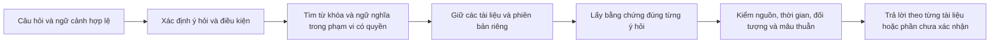

# Báo cáo: RAG tra cứu theo nhu cầu, không phụ thuộc tên tài liệu

Ngày nghiên cứu: 31/10/2026. Repo: `C:/Users/bao.nguyen/Documents/ChatBotProject`, commit `8118dc089dbd65eae2010e10883167f53b9d34e6`. Worktree `repo-restructure` cũng ở commit này tại lúc kiểm tra.

## 1. Kết luận và phạm vi

Mục tiêu của bạn đúng với một trợ lý tri thức nội bộ: người dùng hỏi điều họ cần biết; hệ thống tự tìm nguồn được phép xem, trình bày thông tin theo từng nguồn và không tự bổ sung dữ kiện. Biết tên file chỉ nên giúp thu hẹp tìm kiếm, không phải điều kiện sử dụng.

**Repo đã có tìm kiếm không cần tên tài liệu. Điểm cần cải tiến nằm ở cách diễn giải câu hỏi, giữ đủ nguồn qua các bước lọc và quyết định trả lời/hỏi lại.** Có bằng chứng code về một nhánh bản vẽ yêu cầu chọn tài liệu và prompt hướng người dùng về tên/mã quy trình. Chưa có trace câu hỏi lỗi thực tế, nên không thể quy toàn bộ trải nghiệm bạn gặp cho một nguyên nhân duy nhất.

Hướng đề xuất: giữ nền RAG hiện có; bổ sung hành vi tra cứu theo thông tin và trả lời theo từng tài liệu, giữ danh tính nguồn khi nội dung trùng, phân biệt quyền đọc với phạm vi áp dụng, và kiểm chứng từng kết luận. Chưa có căn cứ để thay model, thay vector database hoặc huấn luyện lại toàn bộ hệ thống.

Đây là báo cáo nghiên cứu, không phải bản sửa hay kết quả nghiệm thu. Chỉ đọc code/tài liệu và nguồn công khai; không chạy dịch vụ, truy vấn SQL/Qdrant thực tế, gọi model của dự án, reindex, sửa cấu hình, commit hay deploy. Các lượt agent phụ gặp giới hạn model/usage; các kết luận dưới đây được đối chiếu trực tiếp lại bằng đọc code và nguồn web.

Phiên làm việc không cung cấp công cụ Deep Research chuyên biệt. Báo cáo dùng quy trình nghiên cứu nhiều nguồn gốc kết hợp khảo sát repo; không tuyên bố đã chạy một tác vụ Deep Research trong giao diện ChatGPT. [Tài liệu OpenAI về workflow nghiên cứu](https://developers.openai.com/api/docs/guides/deep-research).

**Thông tin bạn đã chốt:** không còn nhớ các câu lỗi cụ thể; mặc định muốn liệt kê từng tài liệu, nội dung, khác biệt, bản cũ và phạm vi áp dụng; metadata nghiệp vụ chưa đầy đủ nhưng repo đã có quản lý phiên bản/duyệt/hết hạn. Không cần chờ nhớ lại câu lỗi để đề xuất kiến trúc và bộ kiểm chứng.

## 2. Những yêu cầu cần được chuyển thành hành vi cụ thể

| Nhu cầu | Hành vi đúng | Điều không được suy ra |
|---|---|---|
| Hỏi không biết tên file | Tìm nội dung trong toàn bộ phạm vi được phép xem; tên file là kết quả | Không ép nhập tên file trước khi tìm |
| Nhiều tài liệu nói về cùng chủ đề | Mỗi nguồn có nội dung trả lời, đối tượng, điều kiện, phiên bản và trích dẫn riêng | Cùng từ khóa không có nghĩa cùng một dữ kiện |
| Nhiều nguồn ghi cùng dữ kiện | Có thể gộp câu diễn đạt, nhưng vẫn liệt kê đủ nguồn đã xác nhận | Không xóa danh tính tài liệu chỉ vì câu chữ giống nhau |
| Nguồn ghi khác nhau | Phân biệt khác đối tượng/điều kiện với mâu thuẫn thật; nêu rõ từng nguồn | Không lấy trung bình, biểu quyết đa số hay chọn bản có số version lớn nhất giữa các họ tài liệu |
| Hỏi bằng cách diễn đạt khác tài liệu | Mở rộng cách tìm nhưng giữ nguyên thực thể, phủ định, thời gian, đơn vị và ý hỏi | Không biến giả thuyết tìm kiếm thành sự thật |
| Trả lời tương ứng user | Lọc quyền đọc; sau đó xác định quy định nào áp dụng cho đối tượng được hỏi | Có quyền đọc tài liệu HR không đồng nghĩa mọi quy định trong đó áp dụng cho chính user |
| Tuyệt đối không bịa | Chỉ xuất kết luận có bằng chứng; thiếu thì trả phần có căn cứ và nói rõ phần chưa xác nhận | Không hứa một LLM tự do có xác suất sai bằng 0 |

Ba ví dụ trong yêu cầu là nhóm hành vi cần hỗ trợ, không phải ba câu để hardcode.

## 3. Phát hiện trực tiếp trong repo

Các liên kết dưới đây trỏ tới file của checkout được khảo sát. Số dòng là mốc kiểm tra tại commit nêu trên.

### 3.1. Không có điều kiện bắt buộc tên tài liệu ở mọi câu hỏi

[ChatMessageRequest](C:/Users/bao.nguyen/Documents/ChatBotProject/backend/src/mech_chatbot/api/routers/chat.py:73) nhận `question`; không đòi trường tên file cho chat thông thường. [Nhánh tìm kiếm chung](C:/Users/bao.nguyen/Documents/ChatBotProject/backend/src/mech_chatbot/rag/pipeline_steps.py:1897) chạy dense + BM25 + RRF khi không có mã, mặc định lấy tối đa 30 kết quả qua `rag_general_top_k`. Nó áp dụng `current_published_filter(rbac_filter)`.

Vì vậy, nhận định “chatbot chỉ tìm được khi nhập tên tài liệu” mô tả trải nghiệm sử dụng, chưa phải toàn bộ thiết kế code. Tên file có thể giúp tăng độ chính xác của truy vấn, tránh nhánh hỏi lại hoặc chọn được đúng đối tượng. Cần đo từng bước để biết trường hợp nào đang xảy ra.

### 3.2. Chính sách hỏi lại đang có điểm lệch với yêu cầu mới

[Prompt chung](C:/Users/bao.nguyen/Documents/ChatBotProject/backend/src/mech_chatbot/rag/prompt.py:7) yêu cầu hỏi lại mã/tên quy trình nếu chưa xác định được quy trình/tài liệu. Đây là biện pháp chống trộn dữ kiện, nhưng có thể khiến câu hỏi chủ đề rộng bị xử lý như yêu cầu chọn một tài liệu.

[Nhánh phân giải bản vẽ](C:/Users/bao.nguyen/Documents/ChatBotProject/backend/src/mech_chatbot/rag/pipeline_steps.py:2273) có điều kiện cơ khí và nhiều variant, hoặc ràng buộc mạnh với nhiều họ tài liệu. Nếu resolver trả `ambiguous`, hệ thống kết thúc bằng `multiple_candidates_need_choice` và câu “Bạn muốn tra theo tài liệu nào dưới đây?”. Nếu trả `single`, nó giữ `selected_docs` của một nhóm. Nhánh này không áp dụng phổ quát cho mọi tài liệu hành chính; không được lấy nó để kết luận riêng ví dụ nghỉ phép chắc chắn lỗi ở đây.

[Intent](C:/Users/bao.nguyen/Documents/ChatBotProject/backend/src/mech_chatbot/rag/intent.py:240) đã có `query_scope` gồm `single_candidate`, `compare_candidates`, `general_policy` và `need_disambiguation`. Tìm tham chiếu trong `backend/src/mech_chatbot` chỉ thấy các trường này ở `intent.py`; chưa thấy chúng điều khiển nhánh phân giải nói trên. Đây là điểm nối cần xem xét trước khi thêm một bộ phân loại mới.

**Đề xuất:** với câu hỏi tra cứu thông tin có nhiều đối tượng, trả từng nguồn trước. Chỉ hỏi lại khi cần chọn một kết luận áp dụng cụ thể mà bằng chứng không xác định được. Ví dụ có thể liệt kê dung sai của các bản vẽ tìm được, rồi hỏi người dùng đang thao tác bản vẽ nào; không bắt họ chọn trước để được thấy thông tin.

### 3.3. Có nguy cơ mất danh tính nguồn khi nội dung trùng

[Một nhánh hợp nhất kết quả broad fallback](C:/Users/bao.nguyen/Documents/ChatBotProject/backend/src/mech_chatbot/rag/pipeline_steps.py:1880) dùng `doc.page_content[:200]` làm khóa bỏ trùng. Hai tài liệu khác nhau có cùng phần đầu sẽ bị xem là một trong nhánh này. Đây là nguy cơ có thể suy ra trực tiếp từ code, chưa phải sự cố đã tái hiện trên kho thật.

Đối với yêu cầu liệt kê tài liệu trùng thông tin, khóa bỏ trùng phải bảo toàn ít nhất danh tính tài liệu, phiên bản và vị trí nguồn; có thể gộp đoạn hiển thị giống nhau sau khi lưu tất cả nguồn. Không chỉ sửa vị trí này: khi triển khai phải rà các chỗ hợp nhất, rerank, context, citation và cache dùng chung để tránh nguồn bị mất ở bước khác.

### 3.4. Top-k đoạn văn không chứng minh đã tìm đủ tài liệu

Ngoài giới hạn kết quả retrieval, [rerank](C:/Users/bao.nguyen/Documents/ChatBotProject/backend/src/mech_chatbot/rag/phases/retrieval_rerank.py:132) có `top_n`, cap cấu hình và mở rộng theo từ khóa liệt kê. [Parent context](C:/Users/bao.nguyen/Documents/ChatBotProject/backend/src/mech_chatbot/rag/phases/retrieval_rerank.py:379) có giới hạn section/chunk. Những giới hạn này cần để kiểm soát chi phí; chúng không chứng minh mọi tài liệu liên quan đều có mặt.

Một file dài có thể chiếm nhiều vị trí hơn file ngắn. Tăng k đơn thuần chưa giải quyết được nhu cầu “mỗi tài liệu nói gì”. Cần giữ độ phủ theo tài liệu từ khâu lấy ứng viên tới lúc đưa bằng chứng vào câu trả lời. Khi chưa chứng minh toàn kho đã được rà đủ, dùng “Tìm thấy các tài liệu sau trong phạm vi bạn được xem”, không nói “Chỉ có đúng 3 tài liệu”.

### 3.5. Quản lý phiên bản, duyệt và hết hạn đã có, cần tái sử dụng

| Thành phần đã kiểm tra | Năng lực trong code | Giới hạn kết luận |
|---|---|---|
| [version.py](C:/Users/bao.nguyen/Documents/ChatBotProject/backend/src/mech_chatbot/db/repositories/version.py:92) | Publish version/variant/standalone, archive, rollback; có invalidation cache | Không chứng minh dữ liệu thật được nhập đủ hoặc workflow đang chạy đúng |
| [lifecycle.py](C:/Users/bao.nguyen/Documents/ChatBotProject/backend/src/mech_chatbot/db/repositories/lifecycle.py:43) | Phân loại hết hạn/sắp hết hạn/cần review; cập nhật ngày; refresh expired và đồng bộ metadata | Nhánh phân loại có thể trả `effective` khi không có ngày; đó không phải xác nhận kế hoạch đang thực thi |
| [current_published_filter](C:/Users/bao.nguyen/Documents/ChatBotProject/backend/src/mech_chatbot/rag/retrieval.py:65) | Yêu cầu servable, published, approved, current; loại expired/superseded/draft | Nhánh tìm kiếm chung hiện không phải kho tra cứu lịch sử đầy đủ |
| [serving_state.py](C:/Users/bao.nguyen/Documents/ChatBotProject/backend/src/mech_chatbot/domain/serving_state.py:36) | Kiểm lại trạng thái và ngày hiệu lực/hết hạn; ngày sai định dạng bị chặn | Ngày trống không đồng nghĩa đã xác nhận thời gian nghiệp vụ |
| [pipeline_steps.py](C:/Users/bao.nguyen/Documents/ChatBotProject/backend/src/mech_chatbot/rag/pipeline_steps.py:1926) | Kiểm serving sau retrieval, tránh chờ job cập nhật mới loại tài liệu hết hạn | Cần kiểm riêng mọi đường lịch sử nếu bổ sung |
| [context_builders.py](C:/Users/bao.nguyen/Documents/ChatBotProject/backend/src/mech_chatbot/rag/context_builders.py:87) | Đưa metadata hiệu lực/cảnh báo vào context | Prompt biết trạng thái tài liệu không tự tạo được trạng thái nghiệp vụ |

Không nên xây hệ quản lý phiên bản thứ hai. Cần bổ sung ý nghĩa còn thiếu: `approved` là đã duyệt; `is_current` là bản hiện hành trong họ; `effective/expiry` là thời hạn tài liệu; “kế hoạch đang triển khai” là trạng thái hoạt động, có thể khác cả ba.

Để đáp ứng yêu cầu hiển thị bản cũ: giữ luồng trả lời hiện hành như cũ, thiết kế đường tra cứu lịch sử có quyền riêng và nhãn rõ. Không gỡ chặn expired/draft trong bộ lọc chung. Bản cũ được phép xem có thể xuất hiện ở phần lịch sử; bản bị thu hồi quyền hoặc không được phép phục vụ không được lộ tên, số lượng hay nội dung. Nếu chưa có đường lịch sử được kiểm chứng, nói rõ phần bản cũ chưa được đối chiếu.

### 3.6. Nền ingestion và nguồn đã có, không nên làm lại từ đầu

[Metadata nạp PDF](C:/Users/bao.nguyen/Documents/ChatBotProject/backend/src/mech_chatbot/ingestion/pdf/pipeline_implementation.py:1009) đã mang title, doc number, page, parent section, doc/family/version, trạng thái xuất bản, chủ sở hữu và chính sách xử lý bên ngoài. [Parent hydration](C:/Users/bao.nguyen/Documents/ChatBotProject/backend/src/mech_chatbot/rag/phases/retrieval_rerank.py:379) có sẵn. Bộ xử lý bảng/BOM có vị trí bảng/hàng trong `ingestion/pdf/bom.py`.

Việc cần kiểm chứng trên mẫu thật là câu trả lời có còn gắn với tiêu đề mục, chú thích, điều kiện, hàng/cột và đơn vị sau khi cắt đoạn hay không. Có mã xử lý không chứng minh mọi loại PDF/scan/bảng đều được nạp đúng. Chỉ cải thiện chunking/OCR khi tìm được lỗi mất bằng chứng; không reindex toàn kho trước khi biết thiếu ở đâu.

### 3.7. Trích dẫn đúng ID chưa đủ để chứng minh câu trả lời đúng

[has_valid_source_citation](C:/Users/bao.nguyen/Documents/ChatBotProject/backend/src/mech_chatbot/rag/answer_checks.py:285) kiểm SourceID thuộc tập bằng chứng; đây là kiểm tra cần giữ. Nó không tự chứng minh từng mệnh đề được đúng nguồn đó hỗ trợ. Ví dụ số “10” có trong một nguồn vẫn có thể bị gán nhầm sang kế hoạch khác.

[Evidence gate](C:/Users/bao.nguyen/Documents/ChatBotProject/backend/src/mech_chatbot/rag/evidence_gate.py:161) có heuristic và verifier tùy chọn; khi verifier tắt, kết quả ghi rõ `verifier_disabled`. Không thể coi nhãn sufficient này là chứng minh ngữ nghĩa tuyệt đối. [Streaming policy](C:/Users/bao.nguyen/Documents/ChatBotProject/backend/src/mech_chatbot/rag/streaming_policy.py:12) mặc định ưu tiên buffer rồi kiểm; chưa đọc cấu hình runtime nên không khẳng định thiết lập đang chạy.

## 4. Nghiên cứu bên ngoài và điều thực sự hữu ích cho repo

Nguồn dưới đây là paper gốc hoặc tài liệu của đơn vị xây dựng hệ thống, đã mở trong đợt nghiên cứu. Kết quả công bố trên benchmark của tác giả không được coi là kết quả của repo này.

| Nguồn | Bài học có căn cứ | Áp dụng và giới hạn |
|---|---|---|
| [Lewis và cộng sự, RAG, NeurIPS 2020](https://arxiv.org/abs/2005.11401) | Kết hợp mô hình sinh với bộ nhớ tài liệu được truy xuất | Nội dung công ty nên sống trong kho nguồn có cập nhật/truy vết; không bắt đầu bằng việc dạy model nhớ tất cả file |
| [Anthropic, Contextual Retrieval, 2024](https://www.anthropic.com/research/contextual-retrieval) | Chunk mất ngữ cảnh làm khó retrieval; thêm ngữ cảnh cho embedding/BM25 và rerank là hướng cải thiện | Tận dụng title/section/parent hiện có trước. Nếu sinh mô tả bằng LLM, coi là trợ giúp tìm kiếm; câu trả lời vẫn phải đối chiếu đoạn gốc |
| [Microsoft, Hybrid Search](https://learn.microsoft.com/en-us/azure/search/hybrid-search-overview) | Vector tìm gần nghĩa, lexical hữu ích cho mã/thuật ngữ; kết hợp bằng RRF | Repo đã có nền này. Không đề xuất chuyển sang Azure chỉ để có hybrid |
| [Ma và cộng sự, Query Rewriting, EMNLP 2023](https://aclanthology.org/2023.emnlp-main.322/) | Cách người dùng hỏi có khoảng cách với cách tri thức được viết; rewrite là một điểm cải tiến riêng | Thử original query cùng một số rewrite có giới hạn, đo phần tăng recall và query drift. Không suy ra phải huấn luyện rewriter ngay |
| [Qdrant, Grouping](https://qdrant.tech/documentation/search/search/#grouping) | Có thể trả các nhóm theo document ID, giới hạn số hit mỗi nhóm | Phù hợp tránh một file chiếm hết kết quả. API group có giới hạn và không hỗ trợ offset pagination tại trang đã đọc; không đồng nghĩa liệt kê đủ toàn kho. Kiểm phiên bản SDK/server trước khi chọn API |
| [Gao và cộng sự, ALCE, EMNLP 2023](https://aclanthology.org/2023.emnlp-main.398/) | Đánh giá riêng tính đúng và chất lượng trích dẫn; có citation vẫn có thể thiếu hỗ trợ | Cần đánh giá mỗi kết luận có nguồn đúng và mọi kết luận cần nguồn đều được hỗ trợ |
| [Liu và cộng sự, Lost in the Middle, TACL 2024](https://aclanthology.org/2024.tacl-1.9/) | Vị trí thông tin trong context dài ảnh hưởng kết quả ở các model/tác vụ nghiên cứu | Không khắc phục bằng cách nhét thật nhiều chunk. Chọn bằng chứng theo nguồn và ý hỏi, kiểm model thực tế |
| [Asai và cộng sự, Self-RAG](https://arxiv.org/abs/2310.11511) | Huấn luyện model để quyết định retrieval và tự đánh giá là một hướng nghiên cứu có thực nghiệm | Đây là phương pháp huấn luyện cụ thể, không phải thêm câu “hãy tự kiểm tra” vào prompt là đạt tương đương; chưa cần triển khai cho repo |
| [Microsoft, document-level access](https://learn.microsoft.com/en-us/azure/search/search-document-level-access-overview) | Kiểm quyền ở cấp tài liệu xuyên suốt nạp và truy vấn | Giữ RBAC/site/security và chính sách external AI của repo ở mọi nhánh rewrite, rerank, parent, cache, lịch sử |
| [Edge và cộng sự, GraphRAG](https://arxiv.org/abs/2404.16130) | Graph và community summaries phục vụ tốt một lớp câu hỏi tổng hợp toàn kho trong nghiên cứu | Câu hỏi một chính sách hoặc vài bản vẽ chưa phải lý do bật GraphRAG toàn bộ; summary cũng không chứng minh trạng thái đang triển khai |

**Ý kiến tổng hợp:** độ chuyên biệt của chatbot công ty đến từ nguồn, quyền, cách tìm, mô hình đối tượng/điều kiện, chính sách trả lời và đánh giá bằng câu hỏi nghiệp vụ. Fine-tuning có thể giúp hành vi hoặc retrieval khi có dữ liệu đánh giá tốt; nó không thay được sự thật cập nhật, quyền truy cập, phiên bản và nguồn trích dẫn. Nên sửa lỗi được quan sát trước, chỉ thử fine-tuning nếu lỗi vẫn tồn tại sau khi retrieval và hợp đồng trả lời đã đúng.

## 5. Thiết kế đề xuất trên nền hiện có

### 5.1. Luồng xử lý

1. **Hiểu câu hỏi:** giữ câu gốc; xác định đối tượng, thuộc tính cần biết, thời gian, yêu cầu liệt kê và đối tượng áp dụng. Dùng lịch sử để giải tham chiếu như “cái đó”, không dùng lời chatbot trước làm sự thật. Không mặc định câu hỏi thiếu tên là thiếu điều kiện trả lời.
2. **Tìm thông tin:** giữ dense/BM25/RRF; rewrite chỉ khi cách diễn đạt gây hụt recall, với ngân sách hữu hạn và giữ truy vấn gốc. Tên/mã người dùng nêu rõ vẫn phải được tôn trọng; mở rộng ngữ nghĩa không được bỏ mã, phủ định hoặc thời gian.
3. **Giữ đủ nguồn:** chọn ứng viên theo cả relevance của đoạn và độ phủ tài liệu. Dùng danh tính doc/version/page/chunk khi hợp nhất. Lấy thêm đoạn liền kề/section khi cần hiểu điều kiện; không xóa một nguồn chỉ vì nguồn khác cùng câu chữ.
4. **Bảng bằng chứng nội bộ:** mỗi dòng nối một ý trả lời với đối tượng, giá trị/đơn vị, điều kiện, thời gian, tài liệu/phiên bản và đoạn gốc. Tận dụng các cấu trúc evidence/citation hiện có; không cần tạo knowledge graph mới cho mọi câu.
5. **Kiểm và trả:** nội dung không đủ thì giữ phần có bằng chứng, chỉ ra phần thiếu. Nếu nhiều tài liệu đúng nhưng khác đối tượng, trình bày riêng. Nếu mâu thuẫn thật, báo mâu thuẫn; nếu quan hệ thay thế đã được xác nhận, nêu bản hiện hành và bản cũ trong phần lịch sử được phép.

### 5.2. Cách phân biệt trùng, khác và mâu thuẫn

So sánh trên cùng bộ: **đối tượng + thuộc tính + điều kiện áp dụng + thời gian + đơn vị**. Cùng chữ “dung sai” nhưng khác chi tiết, kích thước, công đoạn hay đơn vị là các dữ kiện khác nhau. Chỉ gọi mâu thuẫn khi các chiều này tương thích mà giá trị hoặc quy định đối lập.

Không dùng số version để so sánh tuổi giữa hai họ tài liệu không liên quan. Không coi nhiều bản sao là nhiều bằng chứng độc lập. Không tự chuẩn hóa đơn vị hoặc suy ra dung sai chung nếu nguồn chưa quy định phạm vi áp dụng.

Mẫu trả lời khi đã xác nhận được ba nguồn: “Mình tìm thấy 3 tài liệu có nội dung trả lời câu hỏi trong phạm vi bạn được xem”, kèm bảng **tài liệu/phiên bản – đối tượng/điều kiện – nội dung liên quan – trạng thái – trang/đoạn**. Con số 3 phải lấy từ kết quả đã kiểm, không lấy từ ví dụ trong yêu cầu.

Nếu có nhiều hơn giới hạn hiển thị, cung cấp xem tiếp từ tập kết quả hợp lệ. Nếu cần cam kết “tất cả tài liệu”, phải có cơ chế rà danh mục/tập nguồn có kiểm soát và theo dõi độ đầy đủ; semantic top-k hoặc group search hữu hạn không đưa ra bảo đảm đó.

### 5.3. Hiểu ý mà không bịa trạng thái

Với ví dụ kế hoạch 30 ngày, hệ thống có thể mở rộng tìm theo kế hoạch, chương trình, lịch triển khai, lịch làm việc. Nó không được thêm điều kiện giả rằng kế hoạch đã bắt đầu.

Nếu chỉ có câu “kế hoạch 30 ngày làm 10 tiếng/ngày”, câu trả lời phù hợp là: “Tài liệu A có kế hoạch 30 ngày, ghi làm 10 tiếng/ngày. Chưa có căn cứ xác nhận kế hoạch này đang triển khai tại thời điểm bạn hỏi.” Nếu có ngày và trạng thái đáng tin cậy thì mới kết luận đang triển khai, kèm mốc thời gian nguồn xác nhận.

Metadata cần bổ sung có chọn lọc cho nhóm câu hỏi này: đối tượng áp dụng, khoảng thời gian hoạt động, trạng thái hoạt động và thời điểm/nguồn xác nhận. Giữ `unknown` khi thiếu; không dùng ngày upload hay ngày duyệt thay ngày bắt đầu. Nếu nhiều kế hoạch có trạng thái khác nhau, trả riêng từng kế hoạch.

### 5.4. “Không ảo giác” cần là chính sách xuất câu trả lời

Không có cơ sở để cam kết LLM sinh tự do không bao giờ sai. Yêu cầu nghiệp vụ vẫn nên giữ nghiêm: **không chấp nhận xuất một kết luận không có chứng cứ**. Thực hiện bằng nhiều lớp, không chỉ một prompt:

- Chặn nguồn sai quyền/phiên bản/ngày; giữ tài liệu là dữ liệu, không phải chỉ dẫn hệ thống.
- Với số liệu/quy định quan trọng, ưu tiên trích xuất và cấu trúc hóa bằng chứng; giữ chủ thể, đơn vị, điều kiện và phủ định.
- Kiểm mỗi kết luận với đúng đoạn hỗ trợ, không chỉ kiểm số hoặc SourceID có xuất hiện đâu đó trong context.
- Chỉ phát nội dung đã qua kiểm tra; timeout hoặc lỗi provider là lỗi xử lý, không được nói thành “kho không có thông tin”.
- Với kết luận chưa xác nhận, trả trích đoạn và giới hạn hoặc hỏi thêm. Verifier dùng LLM vẫn có thể sai, nên kiểm định bằng người và tập đối chứng cho nội dung quan trọng.

Chỉ nói “không tìm thấy bằng chứng trong phạm vi đã tra cứu”, trừ khi thực sự có căn cứ về độ đầy đủ để nói tài liệu/kho không có. Tỷ lệ lỗi bằng 0 trong tập kiểm tra là điều kiện nghiệm thu của tập đó, không phải bảo đảm toán học cho mọi câu hỏi tương lai.

## 6. Phạm vi thay đổi khi được phép triển khai

| Thứ tự | Nơi cần tác động | Kết quả cần đạt |
|---|---|---|
| 1 | `intent.py`, nhánh phân giải trong `pipeline_steps.py`, `entity_resolver.py`, `prompt.py`, chính sách câu trả lời | Tra cứu thông tin không bị ép chọn file; câu cần một đối tượng cụ thể vẫn hỏi đúng điều kiện thiếu |
| 2 | Retrieval/fusion, rerank, parent/context, source snapshot/citation | Không mất tài liệu vì trùng nội dung; giữ đúng nguồn cho mỗi ý; có giới hạn độ đầy đủ rõ |
| 3 | Lifecycle/version/serving và đường tra cứu lịch sử | Tái sử dụng quản lý hiện có; tách lịch sử được phép khỏi kết luận đang áp dụng; không nới quyền |
| 4 | Evidence gate, generation, streaming, cache/history | Mệnh đề gắn đúng nguồn; cache không tái dùng câu trả lời theo chính sách/nguồn/quyền/thời gian cũ |
| 5 | Ingestion/chunking và bộ đánh giá | Chỉ chỉnh loại tài liệu có lỗi thật; bảo toàn bảng, heading, chú thích và đơn vị |
| 6 | API/citation UI và thông báo hỏi lại | Người dùng thấy tài liệu nào nói gì, bấm được đúng phiên bản/trang; xem tiếp khi nhiều nguồn |

Đây là phạm vi khảo sát sửa đổi, không phải chỉ thị sửa tất cả file. Chưa chốt schema mới trước khi đối chiếu các cấu trúc hiện có. Không bật Graph/CRAG/late interaction, đổi embedding, tăng timeout hay reindex toàn kho chỉ để làm báo cáo này thành một dự án lớn hơn.

## 7. Cách chứng minh cải tiến giải quyết đúng vấn đề

Không cần bạn nhớ lại toàn bộ câu lỗi. Lấy mẫu tài liệu đã được phép dùng, người hiểu nghiệp vụ đánh dấu bằng chứng đúng; viết câu hỏi từ nhu cầu công việc trước khi nhìn tên file. Các ví dụ giả chỉ kiểm logic; nghiệm thu cần dữ liệu thật và tài liệu chưa dùng để chỉnh hệ thống.

| Nhóm kiểm chứng | Kết quả bắt buộc |
|---|---|
| Cùng ý hỏi có/không có tên tài liệu | Cả hai lấy đúng bằng chứng; bản không tên không bị yêu cầu nhập tên vô ích |
| Diễn đạt lại, từ đồng nghĩa, thiếu dấu, câu hội thoại nối tiếp | Không đổi đối tượng/phủ định/thời gian; không dùng lịch sử làm bằng chứng |
| Ba nguồn cùng thông tin, một nguồn có nhiều chunk hơn | Liệt kê đủ nguồn trong tập đã biết; không để file dài che nguồn khác |
| Hai nguồn cùng 200 ký tự đầu | Không mất danh tính nguồn sau merge |
| Khác đối tượng so với mâu thuẫn thật | Khác đối tượng được tách; mâu thuẫn thật được báo, không tự chọn |
| Hiện hành, bản cũ, hết hạn, tương lai, thu hồi, draft | Quyền và trạng thái đúng ở retrieval, citation, tải file, cache và lịch sử |
| Đã duyệt nhưng chưa có trạng thái triển khai | Không nói đang triển khai chỉ từ approval/version |
| Nguồn chứa một con số đúng nhưng thuộc đối tượng khác | Không gán số sang đối tượng được hỏi |
| Nguồn không có đáp án hoặc chỉ đủ một phần | Không bịa; trả đúng phần có căn cứ; không từ chối hết khi một phần trả được |
| Cùng câu hỏi qua các user/phòng ban/site | Không lộ tên, nội dung hoặc số lượng nguồn bị cấm; không nhầm quyền đọc với áp dụng |
| Bảng/scan/chú thích, prompt injection trong tài liệu | Bằng chứng giữ vị trí/đơn vị/điều kiện; nội dung tài liệu không điều khiển hệ thống |
| Hết ngân sách/thời gian hoặc lỗi retrieval | Kết quả thiếu/lỗi rõ ràng, không bịa đủ nguồn và không giả “không có dữ liệu” |

Đo riêng: recall bằng chứng, recall tài liệu theo tập nguồn chuẩn, độ đúng của ý định, tỷ lệ hỏi lại không cần thiết, tỷ lệ trả lời được, số mệnh đề không được hỗ trợ, citation correctness/completeness, lỗi quyền/phiên bản/thời gian, p95 và chi phí. Recall cần mẫu số từ nguồn đã kiểm, không từ chính kết quả model lấy được.

So sánh cùng snapshot dữ liệu/quyền/cấu hình: baseline hiện tại; sau sửa quyết định trả lời; sau sửa giữ nguồn; sau rewrite/context nếu còn lỗi. Chỉ chạy các bước cần thiết để phân biệt nguyên nhân, không tạo một ma trận thử nghiệm quá rộng. Giữ một tập tài liệu/câu hỏi độc lập và câu gần nghĩa nhưng đáp án sai để chống học mẹo. Không lấy model tự chấm làm tiêu chuẩn duy nhất.

Điều kiện chặn phát hành: bất kỳ rò quyền, gán sai nguồn/đối tượng, dùng bản hết hạn như hiện hành, bịa trạng thái hoặc số liệu trong tập nghiệm thu. Các chỉ tiêu recall/chất lượng/latency phải chốt theo baseline và mức chấp nhận nghiệp vụ; báo cáo này không tự đặt ra SLA hoặc giả kết quả đạt. Coverage code 80% không thay thế được kiểm chứng RAG này.

Repo có test về serving state, lifecycle, intent, parent hydration và retrieval gates, ví dụ `test_serving_state.py`, `test_lifecycle_partial_dates.py`, `test_fast_intent.py`, `test_parent_context_hydration.py`, `test_retrieval_intelligence_gate.py`. Đã đọc các vị trí liên quan, chưa chạy trong đợt nghiên cứu. Khi triển khai, thêm test tái hiện trước cho hành vi thay đổi và chạy nhóm bị ảnh hưởng, integration đường nguồn/quyền, cùng E2E ba nhóm nhu cầu trên; không coi sự tồn tại của test là bằng chứng chúng đang pass.

## 8. Các quyết định còn cần trước triển khai, không chặn báo cáo

1. Ai được đọc bản cũ/hết hạn và theo cách nào? Quyền này phải dựa vào chính sách hiện có; chưa được tự mở cho mọi user chỉ để liệt kê đủ.
2. Ai xác nhận metadata đối tượng áp dụng và trạng thái triển khai? Mặc định thiếu thì unknown; không yêu cầu nhập đủ metadata cho mọi tài liệu mới cho phép tra cứu nội dung.
3. Chọn một tập tài liệu thật đại diện nhiều phòng ban và người xác nhận đáp án; không lấy ba ví dụ của bạn làm toàn bộ tiêu chuẩn.

Khuyến nghị ưu tiên là chỉnh hợp đồng trả lời và giữ danh tính/độ phủ nguồn trước, rồi mới cân nhắc nâng retrieval hoặc huấn luyện. Kết luận nguyên nhân cụ thể của một câu lỗi thực tế vẫn cần trace; báo cáo đã chỉ ra các điểm code đủ rõ để định hướng việc tái hiện, không giả vờ đã chứng minh chất lượng runtime.

## 9. Đối chiếu phạm vi hoàn thành của báo cáo

| Yêu cầu nghiên cứu | Vị trí đáp ứng |
|---|---|
| Giải thích phụ thuộc tên tài liệu | Mục 3.1–3.4, phân biệt code với trải nghiệm chưa có trace |
| Liệt kê nguồn trùng và từng nguồn nói gì | Mục 2, 3.3–3.4, 5.2, 7 |
| Hiểu ý hỏi mà không suy diễn | Mục 4, 5.1, 5.3 |
| Không bịa, không ảo giác | Mục 3.7, 5.4, điều kiện chặn ở mục 7 |
| Phù hợp user/phòng ban | Mục 2, 4, 5 và kiểm quyền ở mục 7 |
| Kiểm tính năng version/duyệt/hết hạn hiện có | Mục 3.5–3.6, liên kết code trực tiếp |
| Nghiên cứu nguồn gốc và phản biện | Mục 4; giới hạn zero-hallucination, completeness và trạng thái ở mục 5 |
| Đề xuất tận gốc phù hợp repo | Mục 5–7, tái sử dụng nền hiện có và kiểm cả các bước downstream |
| Chưa sửa hệ thống | Chỉ thêm báo cáo này; chưa có thay đổi ứng dụng hay triển khai |

Chưa kiểm runtime, dữ liệu thật hoặc chạy kiểm thử. Rủi ro còn lại: chưa xác định được nguyên nhân của từng câu lỗi lịch sử và chưa chứng minh cải tiến đề xuất trên kho tài liệu công ty.
